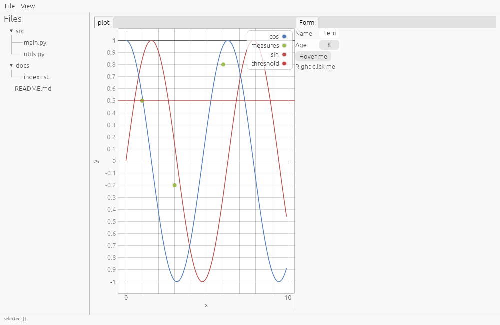
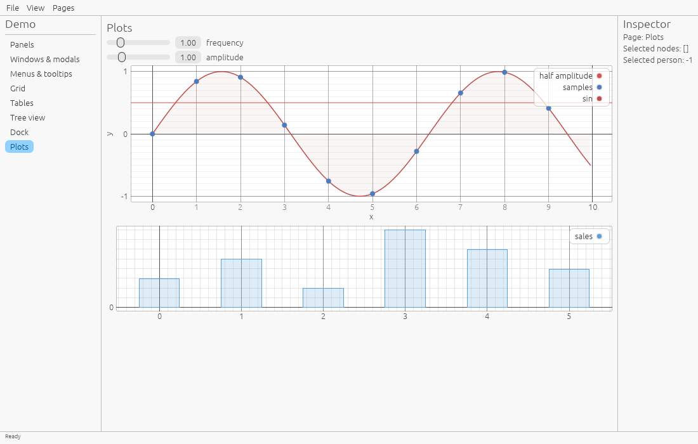
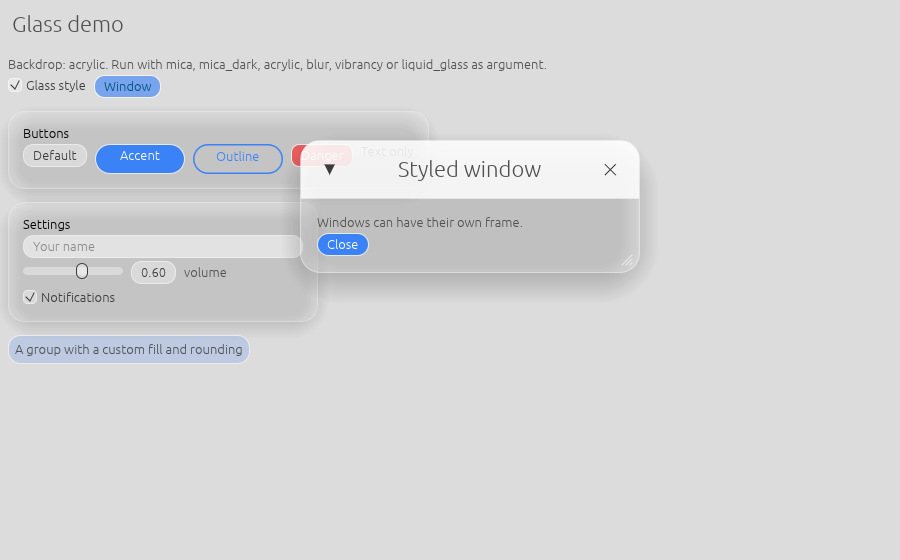
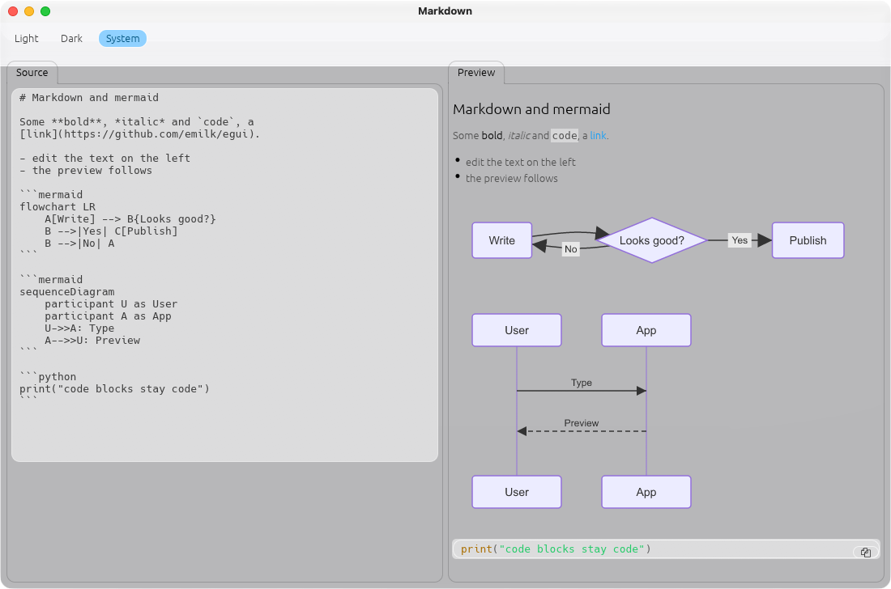
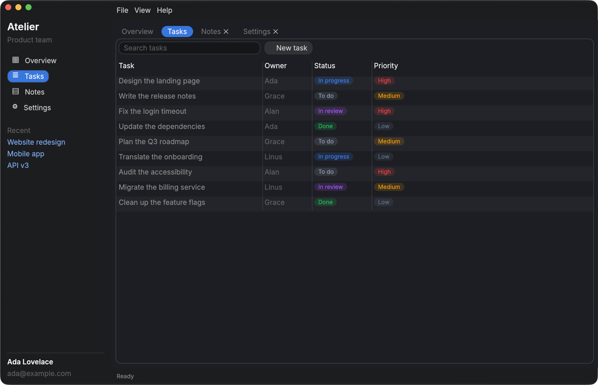
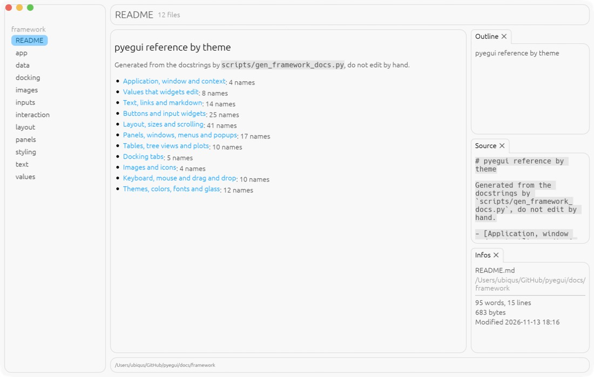
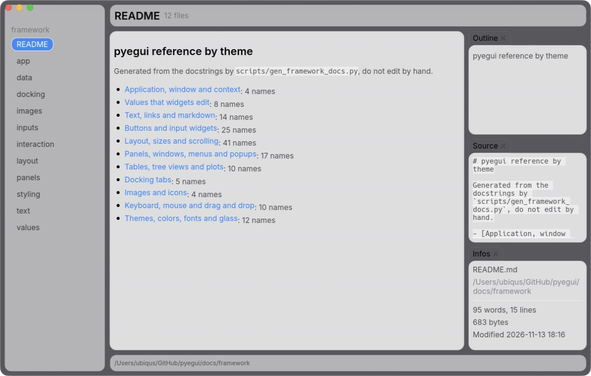
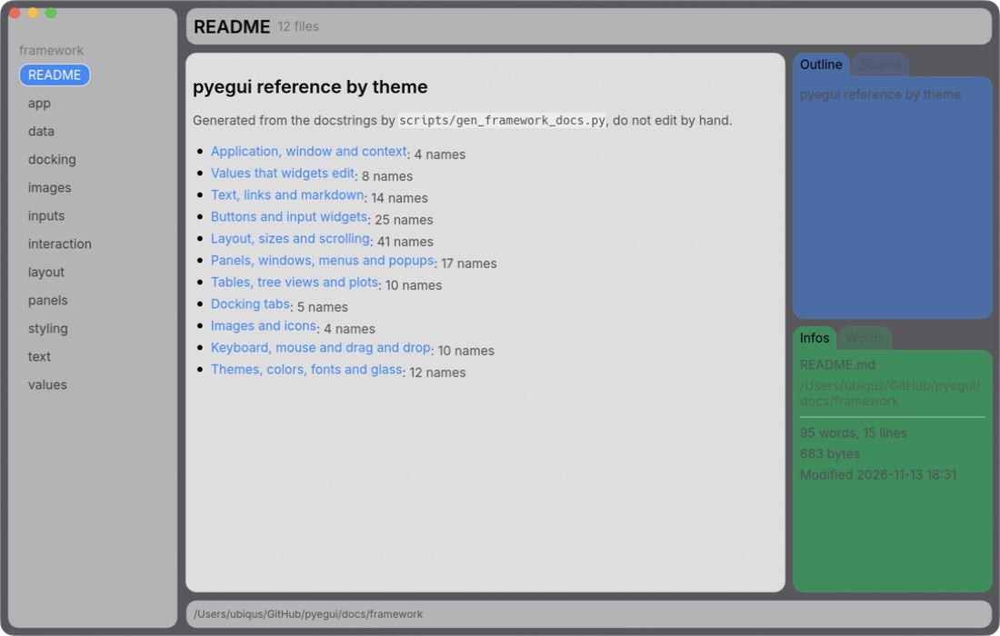

Examples
===========

hello world
-------------

.. literalinclude:: ../examples/hello_world.py
   :language: python
   :linenos:

.. image:: _static/hello_world.png
   :alt: hello world screenshot

pages
-------------

.. literalinclude:: ../examples/pages.py
   :language: python
   :linenos:

.. image:: _static/pages.png
   :alt: pages screenshot

fileviwer
-------------

.. literalinclude:: ../examples/fileviwer.py
   :language: python
   :linenos:

.. image:: _static/fileviwer.png
   :alt: pages screenshot

python IDE
-------------

.. literalinclude:: ../examples/python-ide.py
   :language: python
   :linenos:

.. image:: _static/python-ide.png
   :alt: python ide screenshot

all widgets
-------------

.. literalinclude:: ../examples/widget_gallery.py
   :language: python
   :linenos:

.. image:: _static/widget_gallery.png
   :alt: widget_gallery screenshot

workspace
-------------

.. literalinclude:: ../examples/workspace.py
   :language: python
   :linenos:

demo
-------------

A tour of panels, windows, modals, menus, tooltips, grids, tables, tree views, docks and plots.

.. literalinclude:: ../examples/demo.py
   :language: python
   :linenos:

glass
-------------

Custom styles: glass style with a native backdrop effect, styled buttons, frames and windows.

.. literalinclude:: ../examples/glass.py
   :language: python
   :linenos:

markdown
-------------

A markdown editor with a live preview in a glass dock. Code blocks marked ``mermaid`` are drawn as diagrams.

.. literalinclude:: ../examples/markdown.py
   :language: python
   :linenos:

app
-------------

Atelier, an application with a sidebar, a toolbar, tabs and a status bar in the modern glass style:
partial glass, accent color, Inter font, unified title bar on macOS, badges, switches and plots in the colors of the accent.

.. literalinclude:: ../examples/app.py
   :language: python
   :linenos:

markdown viewer with bars (layout rules)
-----------------------------------------

A sidebar, a top bar, a bottom bar and a dock, laid out with the same gap and corners by ``layout=dict(...)``.

.. literalinclude:: ../examples/markdown_viewer_bars.py
   :language: python
   :linenos:

glass (layout rules)
-------------------------

The same app over a glass backdrop: ``background`` is what is seen between the boxes, ``sheet`` what is seen inside them.

.. literalinclude:: ../examples/markdown_viewer_bars_glass.py
   :language: python
   :linenos:

dock colors
-------------

A blue dock and a green dock, semi transparent, with ``DockPane(sheet=...)``.

.. literalinclude:: ../examples/dock_colors.py
   :language: python
   :linenos:

