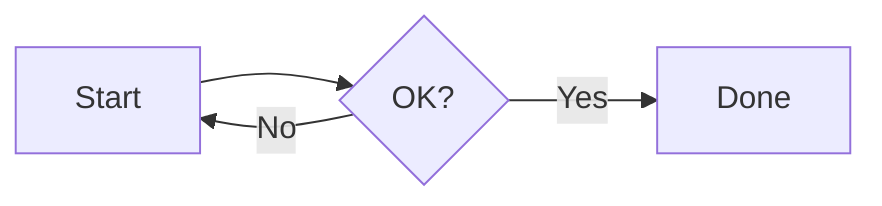
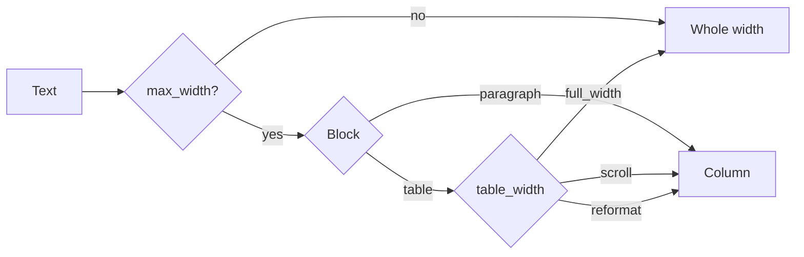
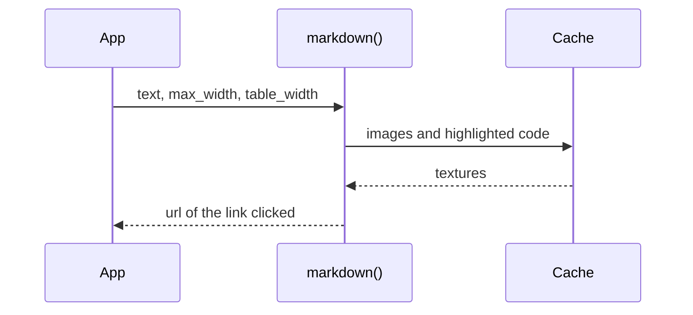
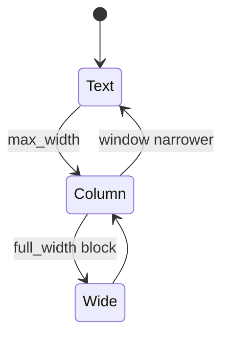
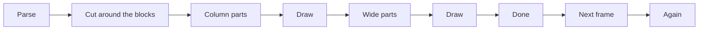

# Markdown: usage and examples

This page is written by hand (the other files of this folder are generated from the docstrings, see
[text.md](text.md) for the list of the keyword arguments of `markdown()`). It is also a test document:
open it in `examples/markdown_viewer.py`, which draws it with the options described below.

## Show a text

```python
from pyegui import markdown, run_native

TEXT = open("README.md", encoding="utf-8").read()

def update(ctx):
    markdown(TEXT, scrollable=True, id="viewer")

run_native("Viewer", update)
```

`scrollable=True` draws only the visible part of a long text. Without `id`, two scrollable texts in the
same window share their scroll position: give each its own.

`markdown()` returns the url of the link clicked in the frame (`open_links=False` leaves the opening to the
app, e.g. a link to another `.md` file).

## Limit the width of the document

A long line is hard to read on a wide window. `max_width` limits the document to a column, and `align`
places it (`"left"` by default, `"center"` or `"right"`).

```python
markdown(TEXT, scrollable=True, id="viewer", max_width=800)                  # a column on the left
markdown(TEXT, scrollable=True, id="viewer", max_width=800, align="center")  # centered
```

A window narrower than `max_width` gets the whole width. The text follows the window when it is resized.

## Tables

`table_width` tells what a table does when it is wider than the document:

| Value | Behavior |
|---|---|
| `"scroll"` (default) | its natural width, with a horizontal scroll |
| `"reformat"` | the cells wrap their text so that the table fits the document |
| `"full_width"` | the same, but the table fits the whole window, out of the column of `max_width` |

```python
markdown(TEXT, max_width=800, table_width="reformat")
```

A table with long cells, to see them wrap. The columns share the room by what their texts need, and never
get narrower than their longest word:

| Function | What it does | When to use it | Notes |
|---|---|---|---|
| `markdown(text, **kwargs)` | Shows markdown text: headings, lists, tables, quotes, code blocks, links and images | Any text that comes from a file or from the user and has a structure of its own | Returns the url of the link clicked during the frame, so that the app can open it itself |
| `markdown_to_pdf(text, path)` | Turns a markdown text into a PDF with the look of `markdown()` | Export of what is shown, with a cover, a table of contents and bookmarks | No window is needed: it can be called from a thread |
| `code_view(text, language)` | A code with syntax highlighting, in a scroll area | A source file, a log, a `.feature` file | The code is not wrapped: the area scrolls sideways |

A narrow table keeps its natural width:

| Key | Value |
|---|---|
| `max_width` | 800 |
| `align` | `"center"` |
| `table_width` | `"reformat"` |

The cells keep **bold**, *italic*, `code`, [links](https://github.com/emilk/egui) and images, because
each of them is drawn by the same viewer as the text.

## Mermaid diagrams

A code block marked `mermaid` is drawn as a diagram: flowcharts, sequence, class, state, ER, pie, gantt and
more. The theme follows the app; `mermaid_theme` forces one of `"default"`, `"dark"`, `"forest"`,
`"neutral"` or `"base"`.

````markdown

````



A sequence diagram:



A state diagram:



A diagram that does not parse shows its error and its source instead of the picture.

## Blocks out of the column

`code_width`, `image_width` and `mermaid_width` take `"reformat"` (default: the block stays in the column
of `max_width`) or `"full_width"` (the block takes the whole window). A wide diagram is the usual case:

```python
markdown(TEXT, max_width=720, mermaid_width="full_width", table_width="full_width")
```



## Limits

- Only the blocks at the top level of the text are concerned by the width options: a table, a code block
  or an image inside a list or a quote stays in the document as it is.
- A reference link (`[text][ref]`) must be defined in the same part of the text as its use, when the text is
  cut around blocks of their own width.
- With `scrollable=True` and a `"full_width"` block or a table `"reformat"`, the whole text is laid out, not
  only its visible part: slower for very long texts.
- The alignment of the columns of a table (`:---:`) is not applied when its cells wrap.
