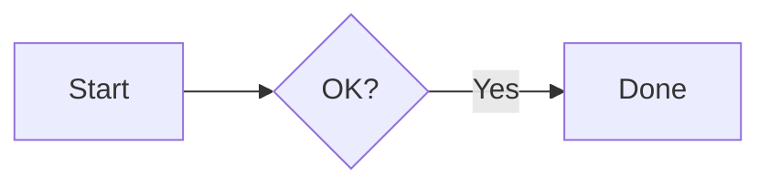

# Text, links and markdown

Functions that show text. They are called every frame, in the order the text appears.

## `heading(text)`

Show large text

**Example:**

```python
heading("hello")
```


## `label(text, size=None, truncate=False, selectable=None)`

Show some text.

**Args**

- `text` (str): the text
- `size` (float): font size of this text only. Default is the size of the body text
- `truncate` (bool): keep the text on one line and end it with … when it is too long for the width, instead of wrapping it. Default is False
- `selectable` (bool): whether the user can select the text to copy it. Default is True. Set it to False when the label is inside an interactive() area, otherwise clicking the text starts a text selection instead of reaching the click of the area around it

**Example:**

```python
label("some text")
label("📁", size=48)
label(file_name, truncate=True)
```


## `small(text)`

Show small text.

**Example:**

```python
small("hello")
```


## `strong(text)`

Show text that stand out a bit (e.g. slightly brighter).

**Example:**

```python
strong("hello")
```


## `weak(text)`

Show text that is weaker (fainter color).

**Example:**

```python
weak("hello")
```


## `monospace(text)`

Show monospace (fixed width) text.

**Example:**

```python
monospace("hello")
```


## `code(text)`

Show text as monospace with a gray background.

**Example:**

```python
code("print(42 + 27)")
```


## `colored_label(color, text)`

Shows a text in the given color.

**Args**

- `color` (color): (r, g, b), (r, g, b, a) or "#rrggbb[aa]"
- `text` (str): the text

**Example:**

```python
colored_label((220, 50, 50), "Error")
colored_label("#22c55e", "Saved")
```


## `badge(text, color=None)`

A small colored label, for a status or a tag.

**Args**

- `text` (str): the text
- `color` (color): the color of the text, the background is a tint of it. Default is the accent

**Example:**

```python
badge("Done", "#22c55e")
badge("Blocked", (239, 68, 68))
```


## `hyperlink(url)`

A clickable hyperlink

**Example:**

```python
hyperlink("https://github.com/emilk/egui")
```


## `hyperlink_to(label, url)`

A clickable hyperlink with label

**Example:**

```python
hyperlink_to("egui on GitHub", "https://www.github.com/emilk/egui/")
```


## `link_clicked(label)`

Clickable text, that looks like a hyperlink.
To link to a web page, use hyperlink or hyperlink_to.

**Example:**

```python
if link_clicked("egui on GitHub"):
  print("clicked on a fake link")
```


## `label_response(text, size=None)`

Shows a text that can be clicked and returns a Response: clicked, double_clicked,
secondary_clicked and hovered.

**Args**

- `text` (str): the text
- `size` (float): font size of the text. Default is the size of the body text

**Example:**

```python
response = label_response("📁", size=48)
if response.double_clicked:
    open_folder()
```


## `markdown(text, **kwargs)`

Shows markdown text: headings, lists, tables, quotes, code blocks, links and images.

**Keyword args**

- `scrollable` (bool): show the text in a scroll area, drawing only the visible part. Faster for long texts
- `id` (str): id of the scroll area, needed if there are several scrollable markdown texts
- `max_image_width` (int): max width of the images
- `default_width` (int): width of the text, default is the available width
- `mermaid_theme` (str): theme of the mermaid diagrams: "default", "dark", "forest", "neutral" or "base".
- Default follows the theme of the app

Code blocks marked ``mermaid`` are drawn as diagrams: flowcharts, sequence, class, state, ER, pie,
gantt and more. A diagram that does not parse shows its error and its source.

**Example:**

```python
markdown('''
# Title
Some **bold** and *italic* text, a [link](https://github.com/emilk/egui).

- item 1
- item 2

```python
print("hello")
```


''')
```
